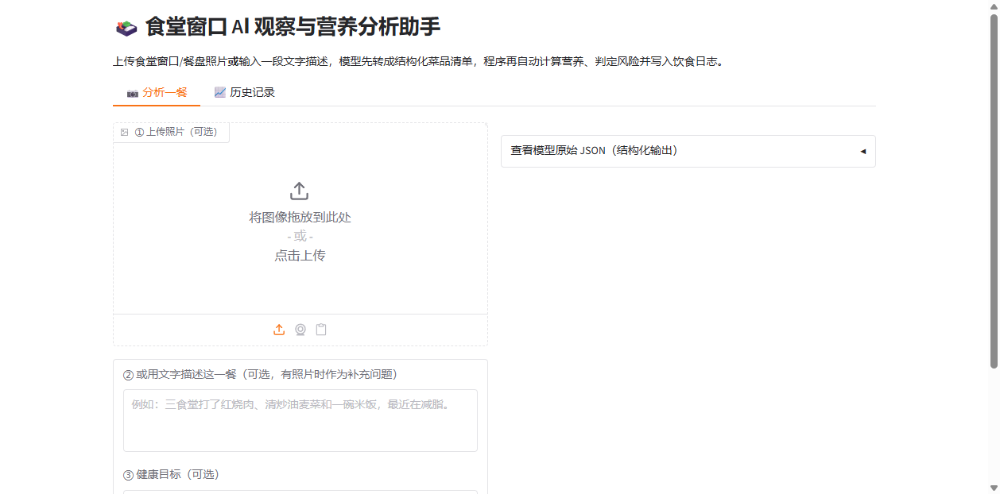
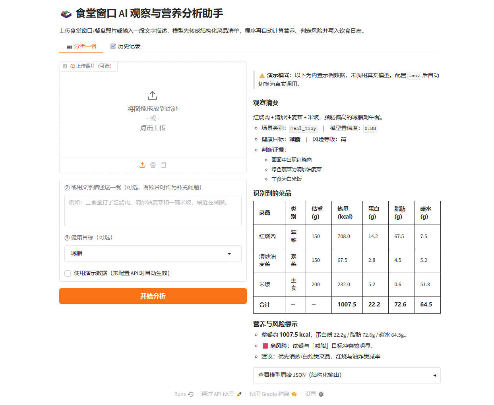
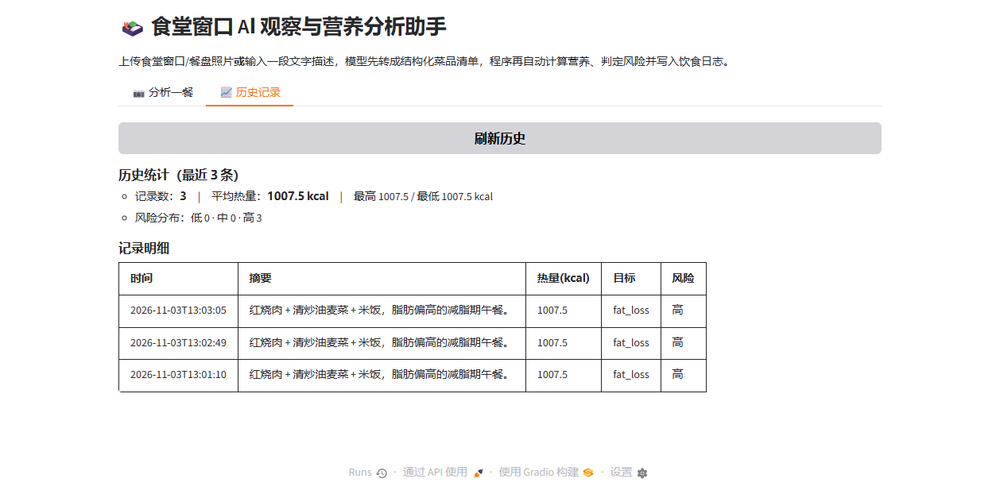
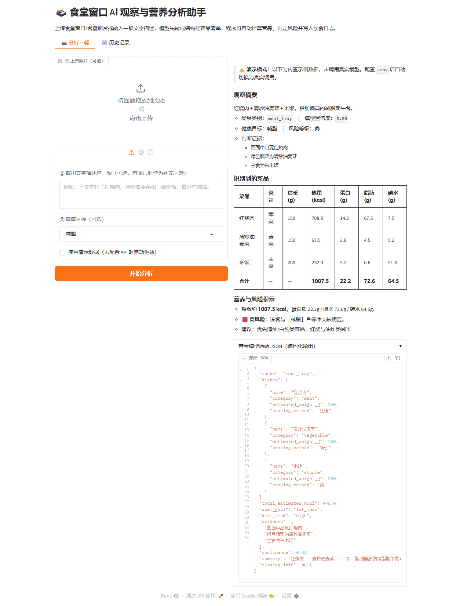

<div align="center">

# 🍱 食堂窗口 AI 观察与营养分析助手

**用多模态 AI 把"这一餐"变成可分析、可记录、可统计的结构化数据**

`Python 3.10+` · `Gradio` · `Pydantic` · `多模态大模型`

[](https://www.python.org/)
[](https://www.gradio.app/)
[](https://docs.pydantic.dev/)
[](LICENSE)

</div>

---

## 📌 简介

一个基于 **Gradio** 的多模态 AI 应用：上传食堂窗口 / 餐盘照片**或**输入一段文字描述，AI 先把这一餐整理成**结构化菜品清单**（由 Pydantic 严格校验），程序再调用本地营养库计算整餐营养、按健康目标判定风险并给出选餐建议，最后把结果**持久化为饮食日志**，支持历史查看与统计。

> 用户只需要"拍一张照"或"说一句话"，就能知道自己这餐摄入了多少热量、蛋白质、脂肪和碳水，以及是否符合自己的减脂 / 增肌 / 控糖目标。

---

## 🎯 应用场景与解决的问题

| 面向对象 | 痛点 | 本项目提供的价值 |
|---|---|---|
| **关注健康的大学生** | 面对食堂大量窗口，难以判断吃什么、吃多少 | 拍照即知营养组成与是否超标的直观回执 |
| **有饮食目标的学生** | 减脂/增肌/控糖却不知道怎么选菜 | 按健康目标给出个性化选餐建议与风险提示 |
| **过敏/忌口人群** | 对菜品成分不确定 | 结构化清单 + 信息补充提示（missing_info） |
| **食堂管理人员** | 想了解师生饮食结构与消费偏好 | 历史记录聚合统计（平均热量、风险分布） |

**核心价值**：把模糊的"这一餐"变成可分析、可记录、可统计的**结构化数据数字资产**。

---

## 🧠 系统流程

```
输入（图片 / 文字描述 + 健康目标）
  → LLM 结构化观察（视觉通道 或 文本通道，二选一）
  → Pydantic 校验（失败自动修正重试，最多 2 次）
  → 营养计算 + 风险阈值复核（结构化结果驱动程序动作）
  → 数字资产落盘（meal_log.jsonl）+ 网页展示
  → 历史记录与统计（第二个标签页）
```

整个流水线围绕一个核心数据契约 `MealObservation` 展开：模型只负责"产出结构化对象"，后续营养计算、风险判定、落盘存储**完全由程序基于结构化字段驱动**，不再依赖自然语言解析。

---

## 📁 项目结构

```
最终项目_食堂窗口AI观察与营养分析助手/
├── app.py                # Gradio 主界面（分析一餐 + 历史记录两个标签页）
├── core/                 # 核心业务逻辑
│   ├── __init__.py
│   ├── schema.py         # Pydantic 数据契约（MealObservation / DishItem）
│   ├── llm.py            # 视觉/文本双通道 LLM 调用 + 解析校验重试
│   ├── nutrition.py      # 营养库 + 计算 + 风险阈值规则
│   └── storage.py        # 数字资产管理（meal_log.jsonl 读写与统计）
├── screenshots/          # 运行截图
├── requirements.txt
├── .env.example          # 环境变量模板
├── .gitignore
└── README.md
```

---

## 🏗️ 架构详解

### 1. 数据契约层 — [core/schema.py](core/schema.py)

用 Pydantic 把模型输出约束为强类型对象，是"结构化输出"最核心的落地：

- `MealObservation`：**9 个字段**（scene / dishes / total_estimated_kcal / user_goal / diet_risk / evidence / confidence / summary / missing_info），中英文描述齐全。
- `DishItem`：嵌套菜品结构，含名称、类别、估重、烹饪方式。
- 约束能力展示：
  - `Literal` 枚举：菜品类别 `staple/meat/vegetable/soup/dessert/drink/other`、场景、目标、风险等级
  - `Optional` 可选字段：`cooking_method`、`user_goal`、`missing_info`
  - `Field` 数值约束：`estimated_weight_g ∈ [0, 2000]`、`dishes ∈ [1, 10]`、`confidence ∈ [0, 1]`
  - **`extra="forbid"`**：模型一旦多输出未定义字段会直接校验报错

### 2. LLM 通道层 — [core/llm.py](core/llm.py)

统一走 **OpenAI 兼容 `/chat/completions` 协议**，双通道共用一套 SYSTEM_PROMPT：

- **视觉通道**（`observe_from_image`）：图片转 base64 data URL 放进 `image_url` 内容块，交给视觉大模型。
- **文本通道**（`observe_from_text`）：把文字描述交给文本大模型（如 DeepSeek）。
- **容错解析**（`extract_json`）：剥掉 Markdown 代码围栏、截取首个 `{` 到末个 `}`。
- **失败自动修正重试**（最多 2 次）：解析/校验失败时，把"上一次输出 + 校验报错"作为修正提示重新请求。

### 3. 营养计算层 — [core/nutrition.py](core/nutrition.py)

拿到结构化对象后由程序完成精确计算，不再使用 LLM 的模糊表述：

- 内置营养库 `NUTRITION_TABLE`（每 100g 热量与三大营养素），支持名称模糊匹配与 `UNKNOWN_NUTRITION` 兜底。
- `compute_nutrition`：按每道菜估重换算，汇总整餐热量 / 蛋白质 / 脂肪 / 碳水。
- `decide_risk`：**用硬阈值复核**模型给出的风险等级，例如减脂目标下热量 > 700 kcal 或脂肪 > 25g 直接判为高风险，完全可复现、可解释。

### 4. 数字资产层 — [core/storage.py](core/storage.py)

- 每次分析结果**追加写入** JSONL 文件（`meal_log.jsonl`，可追加、可重放）。
- 提供读取与聚合统计：平均/最高/最低热量、风险分布、目标分布，供历史页展示。

### 5. UI 层 — [app.py](app.py)

Gradio Blocks 双标签页界面：
- **📷 分析一餐**：上传照片 / 文字描述 / 健康目标 → 输出 Markdown 营养回执 + 可折叠查看的原始结构化 JSON。
- **📈 历史记录**：历史统计 + 明细表格，一键刷新。

---

## 🚀 快速开始

### 环境要求

- Python 3.10+
- 依赖：`gradio`、`requests`、`python-dotenv`、`pydantic`（见 [requirements.txt](requirements.txt)）

### 安装与运行

```bash
# 1. 安装依赖（国内可加国内镜像，见下方提示）
python -m pip install -r requirements.txt

# 2. 配置环境变量
# 复制 .env.example 为 .env，按需填写 VISION_*（图像）或 TEXT_*（文字）模型配置
copy .env.example .env

# 3. 启动
python app.py
```

浏览器访问 **http://127.0.0.1:7860**

> 💡 若 pip 安装缓慢或找不到 gradio，可换国内镜像：
> `python -m pip install -r requirements.txt -i https://mirrors.aliyun.com/pypi/simple/`

---

## 🔑 环境变量配置

| 变量 | 必填 | 说明 |
|---|---|---|
| `VISION_API_URL` | 否* | 视觉模型 OpenAI 兼容端点（须带 `/chat/completions` 后缀） |
| `VISION_API_KEY` | 否* | 视觉模型 API Key |
| `VISION_MODEL` | 否* | 视觉模型名称 |
| `TEXT_API_URL` | 否* | 文本模型端点（默认 `https://api.deepseek.com/chat/completions`） |
| `TEXT_API_KEY` | 否* | 文本模型 API Key |
| `TEXT_MODEL` | 否 | 文本模型名称（默认 `deepseek-chat`） |
| `MEAL_LOG_PATH` | 否 | 饮食日志路径（默认 `meal_log.jsonl`） |

> *标注必填的项，**至少配置一个通道**（视觉或文本）即可完整使用。

### 演示模式

- **未配置任何模型** 或 勾选了"使用演示数据"时，自动进入 **演示模式**：用内置示例数据（红烧肉 + 清炒油麦菜 + 米饭）走通全流程。
- 演示结果会明确标注 **"⚠️ 演示模式"**，诚实表明未调用真实模型，**不伪造模型结果**。
- 配置好任一通道后即自动切换为真实模型调用。

---

## 🖼️ 运行截图

| 主界面 | 分析结果 | 历史记录 | 结构化输出 |
|---|---|---|---|
|  |  |  |  |

---

## 🎓 课程要点与本项目的对应关系

| 课程主题 | 在本项目中的落地 |
|---|---|
| **Pydantic 结构化输出** | `core/schema.py`：9 字段 + 嵌套 DishItem，含 `Literal` / `Optional` / `Field` 约束 / `extra="forbid"` |
| **多模态 API** | `core/llm.py`：视觉（`image_url`）与文本两个通道，统一 OpenAI 兼容协议 |
| **数字资产管理** | `core/storage.py`：结果追加写 `meal_log.jsonl`，支持读取与聚合统计 |
| **失败处理** | 解析 / 校验失败带报错信息做修正重试，最多 2 次 |
| **程序动作驱动** | 结构化结果 → `compute_nutrition` / `decide_risk` 硬阈值复核，不依赖自然语言 |

---

## 🧪 技术亮点

- **强类型数据契约**：整条链路围绕同一个 Pydantic 模型，杜绝"模型输出漂移"问题。
- **诚实透明**：演示模式明确标注，不伪造 AI 结果；风险判定有确定性的阈值规则。
- **数据可积累**：每次分析都落盘为数字资产，形成可统计、可回溯的个人饮食日志。
- **容错健壮**：模型偶发返回 `null` 时用保守估值兜底，解析失败自动重试修正。

---

## 📄 License

[MIT](LICENSE) © 2025